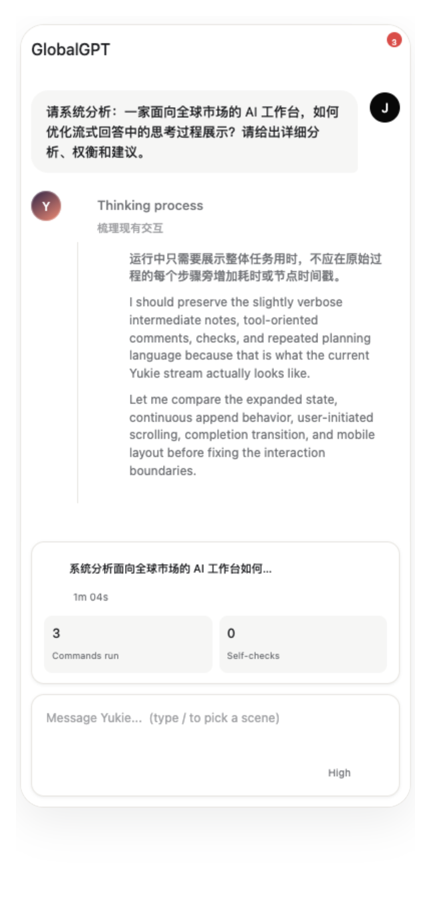

# AI Product Lab · 仲家傲 / Jazzy Zhong

这是我的 AI 产品作品仓库：记录我如何从用户问题出发，设计 Agent、多端体验和 AI 创作工具，再用真实使用数据继续改进。

我是对外经济贸易大学精算学本科生，目前在焱法科技参与面向海外用户的 AI 产品工作，关注 Agent、生成式 AI、多端体验、产品数据和快速落地。

## What I can do

| 方向 | 我做过的事情 |
| --- | --- |
| 🤖 Agent 产品 | 场景拆解、Skills / Connector 整理、工作流、Prompt 与模型效果评测 |
| 🎨 多端体验 | Web、移动端、Mac 客户端和 Chrome 插件的入口、任务状态与交互设计 |
| 🛠️ Product building | 独立提出方案、画原型、协同研发；使用 Codex 辅助开发页面和功能 |
| 📊 产品数据 | 使用 PostHog 与业务数据拆解漏斗、复现任务、定位 Bad Case，并形成优化建议 |

## Selected work

### 01 · Yukie 多端 Agent

从移动端没有 Agent 入口开始，设计首页场景、PPT / 生图 / 生视频入口、上传、任务进行中与完成后的状态，以及 Skills 和 Connector 的适配。

Mac 客户端从 0 到 1 设计两版，加入 `Task / Agent / Create` 模式切换；同时参与 Chrome 插件与云端联动路径。

**公开证据**：移动端 Agent 28 天有 3,057 位访客、956 位发送用户和 5,139 次请求；这些数字只描述使用规模，不等同于留存或满意度。

→ [案例详情](docs/01-yukie-multi-platform-agent.md) · [移动端 Demo](https://jazzy179.github.io/Jazzy179/mobile-yukie.html) · [Mac Demo](https://jazzy179.github.io/Jazzy179/mac-client.html) · [Chrome Demo](https://jazzy179.github.io/Jazzy179/browser-agent.html)

### 02 · AI Video Editor

独立负责 Video Editor 的需求拆解、功能与 UI 设计、页面开发、数据面板、研发协同和上线维护，已经完成两轮迭代。

在 43 位用户、56 个有效会话的样本中，39 个会话的首轮诉求属于创意包装或基础剪辑；素材导入 99 次调用中有 90 次失败。基于这些观察，我把素材可用性预检、路径校验和失败恢复列为下一轮优化方向。

→ [案例详情](docs/02-ai-video-editor.md) · [在线产品](https://www.glbgpt.com/video-edit) · [交互录屏](https://jazzy179.github.io/Jazzy179/video-editor-demo.mp4)

### 03 · 用户任务复现与产品数据

使用 PostHog、业务数据库和用户反馈，分析“进入、发送、查看结果、保存、外部动作执行”等环节，人工复现复杂任务并判断问题来自交互、Connector、模型输出还是权限。

目前形成 17 项优化建议：Connector 6 项、网站 5 项、Research 6 项，分析结论经过负责人审核。

→ [案例详情](docs/03-product-data-and-task-evaluation.md)

### 04 · Created / Asset 详情页

针对 Created 按钮过多、顺序混乱，以及 Asset 缺少继续处理所需信息和操作的问题，独立提出方案、设计原型与交互，并使用 Codex 辅助完成开发。

交付覆盖图片、视频共 4 组页面，进入正式代码库并通过代码审核。

→ [案例详情](docs/04-created-asset-detail.md)

### 05 · 用户反馈与需求提炼

与 CEO 共同发起用户邮件反馈，负责阅读归纳、追问和需求提炼。反馈推动了 Video Editor 的迭代与当前再设计，也帮助团队识别素材、数字人、浏览器助手和长片创作流程中的验证方向。

→ [案例详情](docs/05-user-research-and-feedback.md)

## Public links

- [个人网站](https://jazzy179.github.io/)
- [GitHub 个人主页](https://github.com/Jazzy179)
- [作品集：概括版 · 8 页](https://jazzy179.github.io/portfolio-overview-v19.1.pdf)
- [作品集：核心案例 · 12 页](https://jazzy179.github.io/portfolio-core-cases-v19.1.pdf)
- [PDF 合集](https://jazzy179.github.io/portfolio-v19.1.zip)

## 关于数据和保密

这里仅展示已经整理为公开材料的内容。内部代码、用户身份、原始业务数据和未发布路线图不会上传。案例中的数据会注明统计窗口、样本范围和限制；“系统处理结束”不等于“用户任务完成”，交付文件也不等于最终成片通过验收。

## Background

- 对外经济贸易大学 · 精算学本科
- 华福证券研究所 · 电子组研究实习
- 焱法科技 · AI 产品实习
- 正在系统学习 Python、pandas、时间序列、因子与回测

欢迎通过 [个人网站](https://jazzy179.github.io/) 或 [邮箱](mailto:jazzyzhong@163.com) 联系我。
