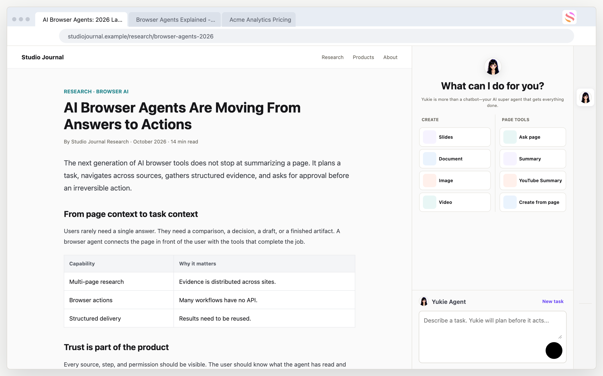
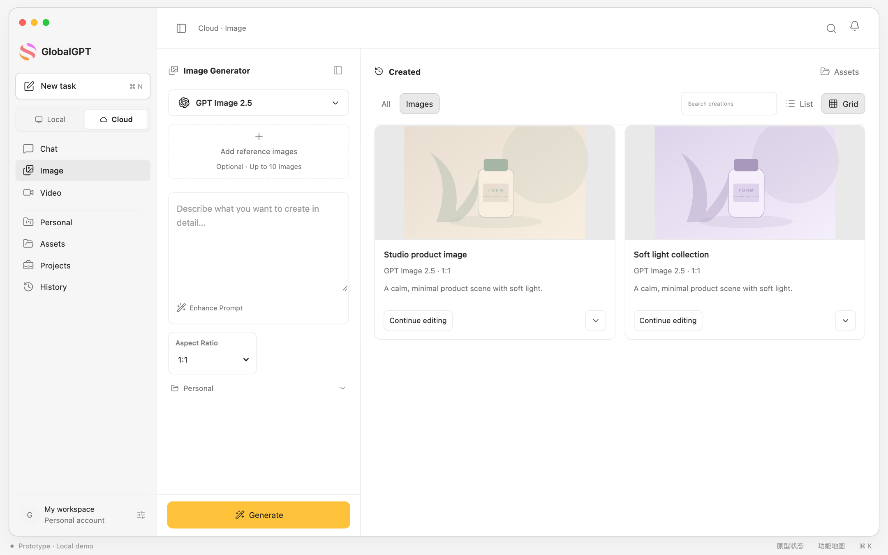

# Yukie 多端 Agent

## 一句话

把同一个 Agent 从 Web 延展到移动端、Mac 客户端和 Chrome 插件，让用户在不同设备上都能找到清晰的入口、知道任务进行到哪一步，并继续处理结果。

## 背景

移动端原本没有 Agent 区域；Mac 客户端需要从零建立聊天与多模态工作区；Chrome 插件需要让用户清楚本次是否使用网页资料，以及任务结果在哪里继续处理。

## 我的工作

- 设计移动端首页的 Agent 区域、场景入口和功能摆放。
- 设计 PPT、生图、生视频、上传照片等任务的开始、进行中和完成后状态。
- 适配 Skills 与 Connector 在移动端的使用路径。
- 从 0 到 1 设计 Mac 客户端两版：第一版是多模型 Chatbot；第二版加入 Yukie Agent、生图生视频，早期按 `Task / Agent / Create` 分类，后续调整为 `Local / Cloud`，先区分本机和云端的工作范围。
- 参与 Chrome 插件与云端联动的产品路径设计。
- 与研发协作、验收实现效果，并根据使用数据继续调整。

## 使用数据

移动端原生 App 的 28 天统计窗口内：

| 指标 | 数值 | 解释 |
| --- | ---: | --- |
| 进入 Agent 的用户 | 3,057 | 打开过 Agent 页面的去重用户，不是入口曝光人数 |
| 发过消息的用户 | 956 | 占进入用户 31.3% |
| 用户发送请求 | 5,139 | 平均每位发送用户 5.4 次 |
| 生图 / 生视频场景请求 | 1,656 | 占全部发送 32.2% |
| 成功保存结果 | 810 | 844 次保存操作中成功比例 96.0% |

统计窗口：2026.09.29—10.26。记录包含环境未标明的记录，未剔除内部或测试账号，因此只作为产品使用观察，不写成增长或留存成果。

844 次保存操作包含 810 次成功、15 次失败，以及统计结束时仍未返回结果的 19 次。查看、发送和保存使用了不同统计对象，不能直接拼成同一条转化路径。完整定义见[统计范围说明](data-notes.md)。

## 两个具体取舍

**移动端首页：保留自由输入，同时给出任务示例。** 我没有采用把全部快捷功能放在视觉中心、输入框置底的方案，担心用户因此认为只能选择已有功能。最终保留主输入区，在下方提供场景入口。这是设计判断，后续仍需观察新用户是否理解。

**Chrome：由用户主动选择使用网页资料。** 直接创作默认不附带当前网页；网页工具使用当前页并保留来源。轻量问答留在侧栏，完整成品回到主站对应的结果页查看和继续编辑。

*原型展示网页内容与侧栏任务的关系，页面文章为演示内容。*

*最新 Mac 方案原型，先区分本机与云端工作范围，再组织聊天、图片和视频功能。*

## 结果与边界

移动端 Agent 于 9.29 上线，Chrome 插件于 10.21 进入生产；Mac 首版于 9.24 上线，第二版截至 10.27 最近确认信息仍待上线。上述日期均为 2026 年。本人负责方案与交互，CEO 和产研负责人审核，移动端与 Mac 由研发实现。

→ [移动端 Demo](https://jazzy179.github.io/Jazzy179/mobile-yukie.html) · [新版 Mac Demo](https://jazzy179.github.io/mac-client-v2.html) · [Chrome Demo](https://jazzy179.github.io/Jazzy179/browser-agent.html)

[返回作品目录](../README.md)
