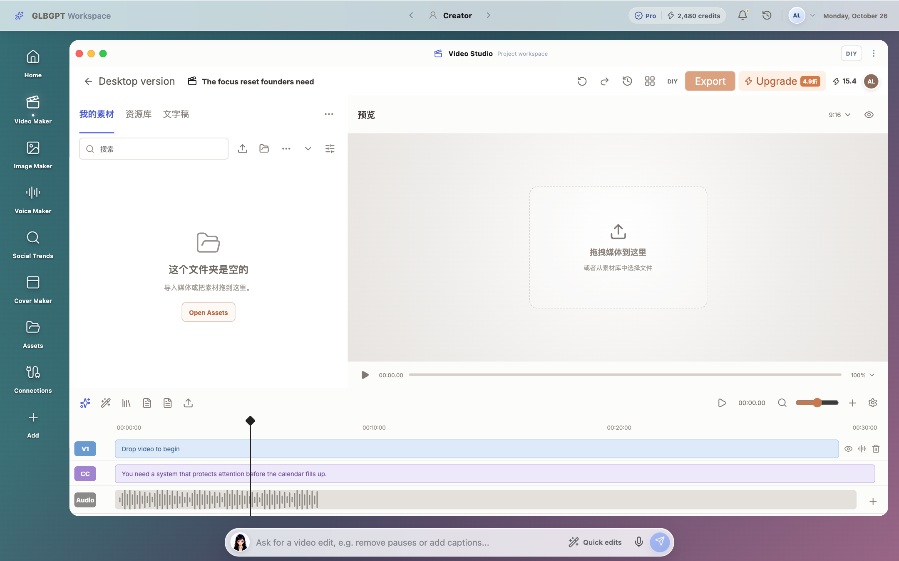

# AI Video Editor

## 一句话

从需求拆解到页面开发和数据复盘，独立推进一个面向海外用户的视频创作产品，并把用户真实卡点带入下一轮设计。

## 我负责什么

- 拆解视频创作场景和功能范围。
- 设计编辑器的页面结构、交互和素材组织方式。
- 使用 Codex 辅助完成页面开发，协同前后端完成上线。
- 建立数据面板，复盘用户指令、素材导入和文件交付。
- 更新素材、维护线上页面，并基于用户反馈推进再设计。

## 数据观察

从首条可查用户消息 2026.09.15 17:47:45 至 10.22 20:20:38（北京时间），编辑器内 Agent 助手样本包含 43 位用户、56 个有效会话和 205 条用户指令；20 位用户在 23 个会话中收到 53 个视频文件。收到文件只说明交付发生，尚未取得每份成片的用户验收结果。

进一步拆解后发现：

- 39 / 56 个会话（69.6%）的首轮诉求是创意包装或基础剪辑。
- 素材导入共开始 99 次，90 次失败；其中 64 次涉及文件不可见，26 次涉及路径格式不符合要求。

这里的 90 / 99 是调用失败比例，不能直接当作 90 位用户失败，也不能代表编辑器全部访客。

*交互原型示意。每个会话的需求按首条消息人工归为一类；同一个人可能多次重试导入。详见[统计范围说明](data-notes.md)。*

## 产品动作

基于上述问题，我把下一轮优化拆成三个方向：

1. 导入前检查素材是否可用；
2. 在提交前校验文件路径和格式；
3. 失败后给出可恢复的下一步，而不是只显示系统错误。

这些是基于样本形成的优化方向，效果需要上线后继续验证。

## 用户反馈

与 CEO 共同发起用户邮件反馈后，我参与整理创作者对镜头清单、连续性记录、素材复用和逐镜头组装的需求，并将反馈用于 Video Editor 迭代和当前再设计。

9.14 上线后已迭代两版；收到素材不足反馈后，推动团队生成并上新素材。数字人相关方案已进入开发；镜头管理仍是待验证方向。

→ [在线产品](https://www.glbgpt.com/video-edit) · [交互录屏](https://jazzy179.github.io/Jazzy179/video-editor-demo.mp4)

[返回作品目录](../README.md)
