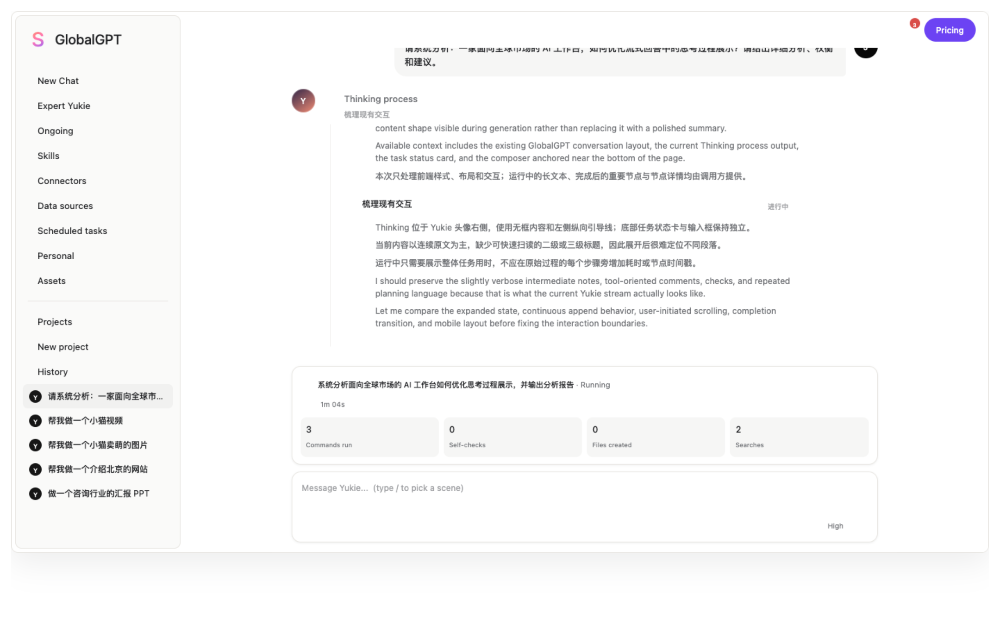

# 用户任务复现与产品数据

## 一句话

把“系统说完成了”拆成用户是否真的完成目标，结合事件数据、业务数据和人工复现，定位 Agent 任务为什么没有交付。

## 工作流程

1. 用 PostHog 和业务数据库确认任务发生了什么。
2. 按进入、发送、查看结果、保存、外部动作执行等环节拆解路径。
3. 复现未完成的复杂任务，区分交互、Connector、模型输出和权限问题。
4. 把原因写成需求、验收条件和后续验证方案。
5. 将结论提交负责人审核，再推进产品调整。

## 关键发现

### Connector 任务

141 轮 Connector 相关任务中，118 轮（83.7%）被标记为系统结束，但只有 45 轮（31.9%）观察到成功的外部调用。

这说明“系统停止处理”和“外部动作真的执行”是两个不同结果，不能用前者替代后者。

统计采用 2026.10.19 第二轮分析快照，从最近 3,000 个会话中取样，并排除开始不足 6 小时的任务。没有观察到成功调用，还需要结合用户原始目标和记录进一步核对。

*用于说明任务状态展示的原型，图中内容不是上述 141 轮任务的原始记录。*

### 左侧栏

在 1,804 位左栏点击用户中，70.8% 使用过新建对话，Skills 和 Connectors 分别覆盖 26.2% 和 22.6%。

因此左侧栏重设计的方向是突出主入口、收拢低频功能，同时保留有人使用的 Skills 和 Connectors 二级入口。

统计窗口为 2026.09.22 00:02—10.22 00:02（北京时间），限定新 Yukie 左栏，共 10,907 次点击。用户可以点击多个入口，所以各比例允许重叠；缺少曝光记录，不能据此计算曝光点击率。

## 产出

目前形成 17 项优化建议：Connector 6 项、网站 5 项、Research 6 项。分析结论已经过负责人审核，左侧栏重设计已进入开发；17 项需求的正式评审与实施记录仍待补充。

## 我学到的

AI 产品的状态设计必须回答三个问题：系统做了什么、交付物有没有产生、用户目标有没有完成。只有看到最后一个问题，才能判断任务是否真正成功。

补充工作包括俄罗斯市场的使用与付费路径分析，目前保留分析职责，尚无可公开核实的转化或收入改善数字。

[统计范围说明](data-notes.md) · [返回作品目录](../README.md)
